<p>
  
</p>

# 소비로그 Flutter 앱

> 영수증 한 장으로 무엇을 샀는지까지 기록하는 가계부

소비로그는 영수증 사진이나 결제 화면을 올리면 가게 이름, 결제일, 품목, 수량, 금액을 읽어 가계부에 채워주는 앱입니다. 입력된 내용을 확인해 저장하고, 월별 소비와 지출 목표를 살펴보거나 함께 산 품목을 나눠 정산할 수 있습니다.

[App Store에서 다운로드](https://apps.apple.com/kr/app/%EC%86%8C%EB%B9%84%EB%A1%9C%EA%B7%B8-%EC%98%81%EC%88%98%EC%A6%9D-%EB%93%B1%EB%A1%9D-%EA%B0%80%EA%B3%84%EB%B6%80/id6815716175)

소비로그의 Flutter 클라이언트 저장소입니다. 현재 체크아웃에는 iOS 네이티브 프로젝트가 포함되어 있습니다. Flutter로 화면을 구성하고, 백엔드 API를 통해 인증·영수증 인식·가계부·분석·정산 기능을 연결합니다.

## 주요 기능

| 핵심 기능 | 사용 방법 |
| --- | --- |
| 영수증 인식 | 영수증을 촬영하거나 결제 화면 캡처를 불러옵니다. 자동으로 채워진 품목과 추천 카테고리·결제수단을 확인하고 저장 전에 수정할 수 있습니다. |
| 가계부 | 수입과 지출을 직접 입력하고 일·주·월 단위로 조회합니다. 카테고리와 결제수단으로 원하는 내역을 골라 볼 수 있습니다. |
| 소비 분석과 목표 | 월별 카테고리 지출을 비교하고, 지출 목표를 설정해 남은 예산과 하루에 쓸 수 있는 금액을 확인합니다. |
| 품목별 더치페이 | 각 품목의 값을 나눠 낼 사람을 선택하면 참여자별 정산 금액이 계산됩니다. 계좌 정보와 금액이 담긴 정산 요청을 복사하거나 공유할 수 있습니다. |

## 앱 화면

| 영수증 촬영 | 인식 결과 확인 | 홈 · 월간 소비 요약 |
| :---: | :---: | :---: |
|  | 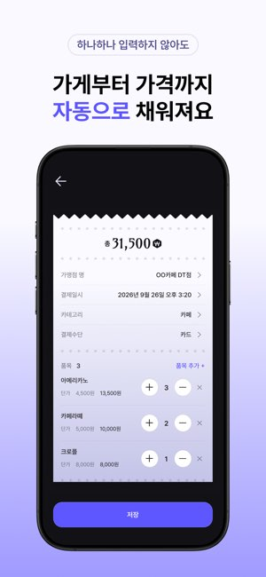 | 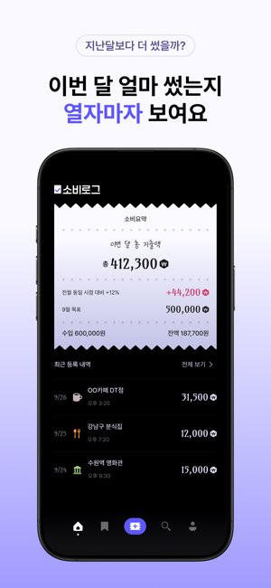 |

| 카테고리별 소비 분석 | 더치페이 · 품목별 인원 배정 | 더치페이 · 정산 요청 |
| :---: | :---: | :---: |
|  | 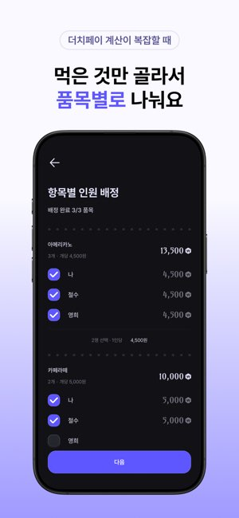 | 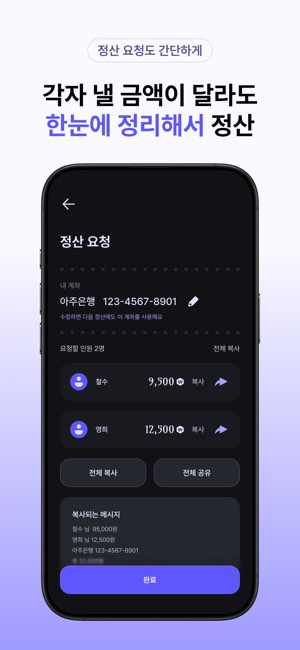 |

위 6장은 [App Store의 iPhone 미리보기](https://apps.apple.com/kr/app/%EC%86%8C%EB%B9%84%EB%A1%9C%EA%B7%B8-%EC%98%81%EC%88%98%EC%A6%9D-%EB%93%B1%EB%A1%9D-%EA%B0%80%EA%B3%84%EB%B6%80/id6815716175)입니다. 아래는 예시 데이터를 사용한 앱 QA 및 UI 테스트 캡처이며, 일부 화면은 개발 중인 버전에서 촬영했습니다.

### 수입·지출 등록

| 지출 직접 등록 | 수입 등록 | 카테고리 추가 |
| :---: | :---: | :---: |
| 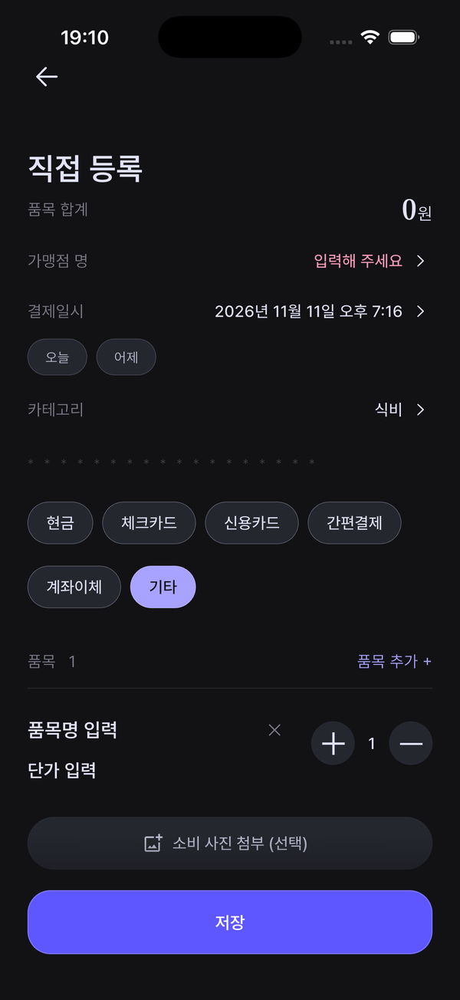 | 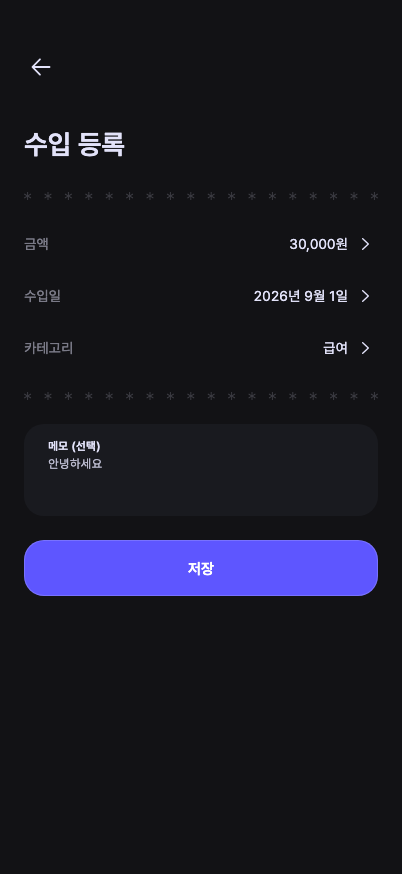 | 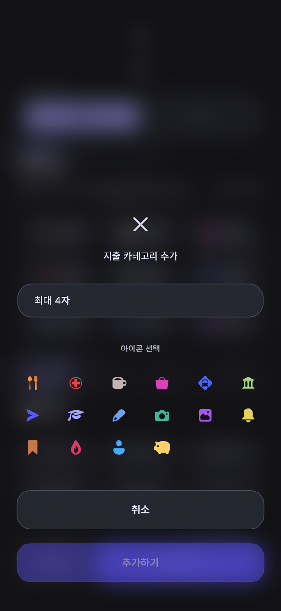 |

### 가계부 조회

| 월간 가계부 | 내역 필터 | 지출 상세 |
| :---: | :---: | :---: |
| 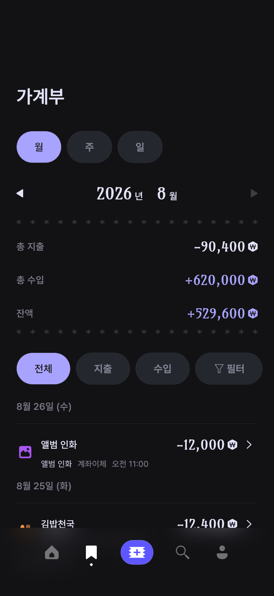 | 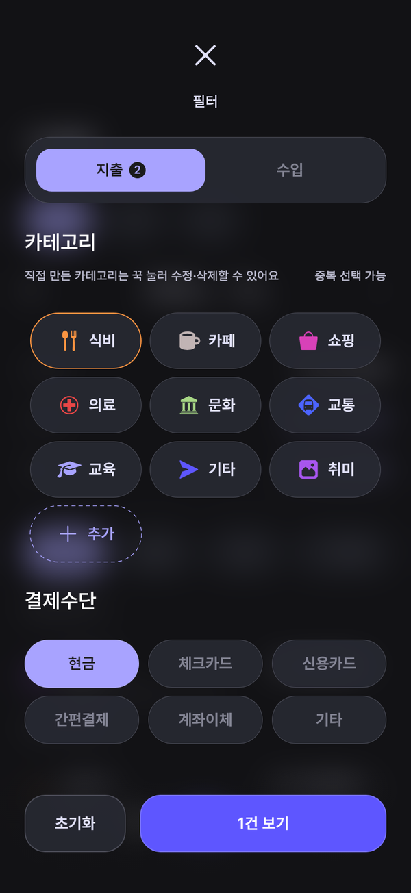 | 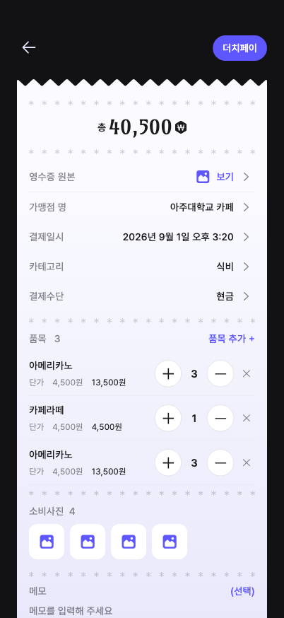 |

### 지출 목표와 소비 리포트

| 지출 목표 설정 | 소비 패턴 리포트 | 반복 지출 분석 |
| :---: | :---: | :---: |
| 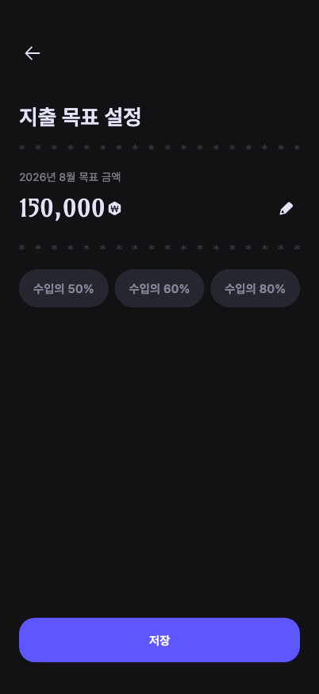 | 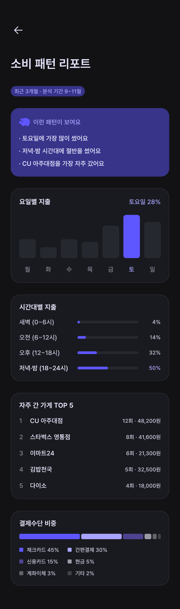 | 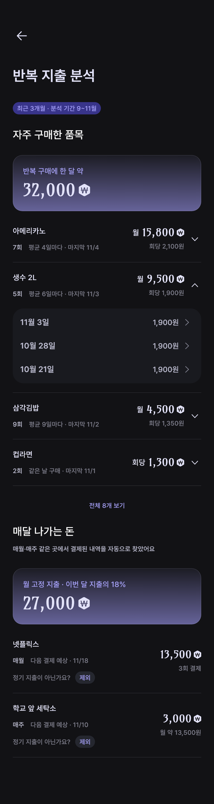 |

### AI 분석

| AI 분석 탭 | 소비 습관 진단 | 할인 찾기 |
| :---: | :---: | :---: |
| 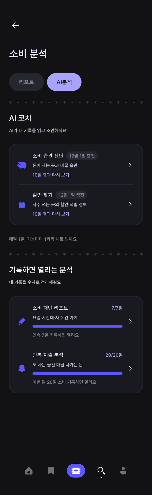 | 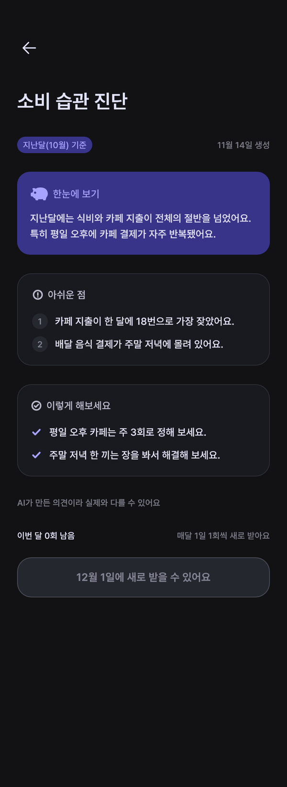 | 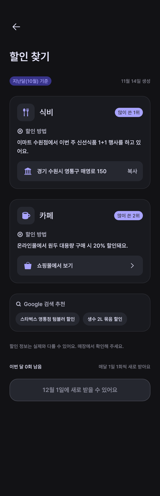 |

### 더치페이 설정과 정산 결과

| 참여자 등록 | 정산 결과 | 은행 선택 |
| :---: | :---: | :---: |
| 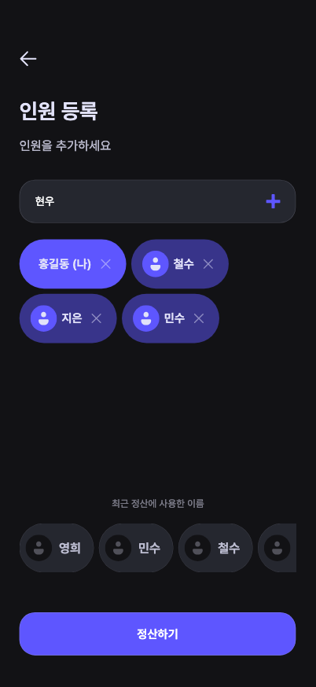 | 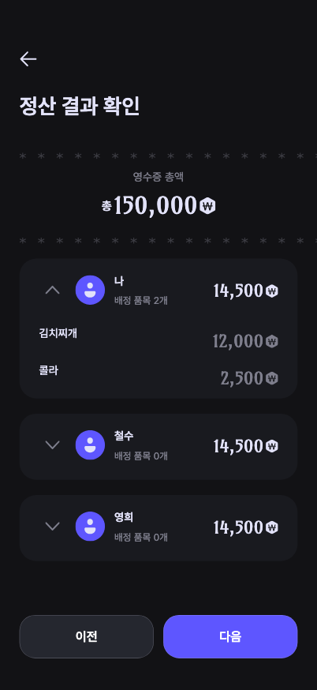 | 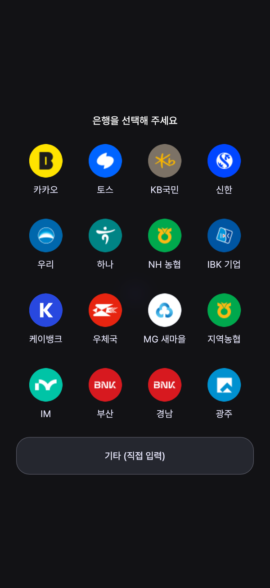 |

### 기록 관리

| 마이페이지 | 출석 현황과 무지출 기록 | 연속 기록 보상 |
| :---: | :---: | :---: |
| 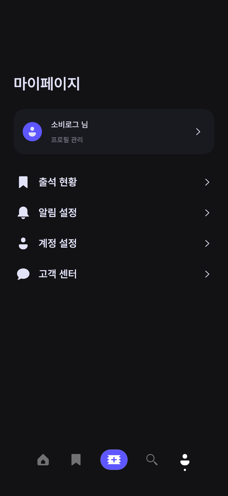 | 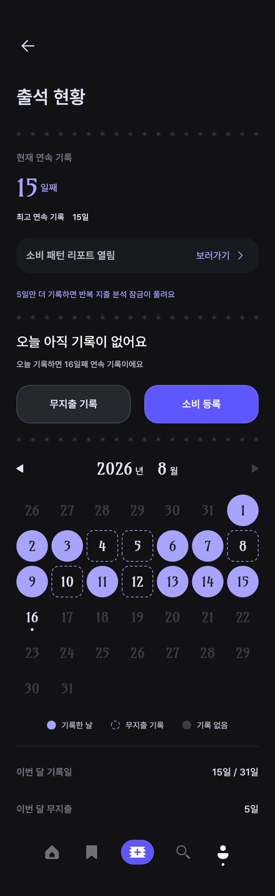 | 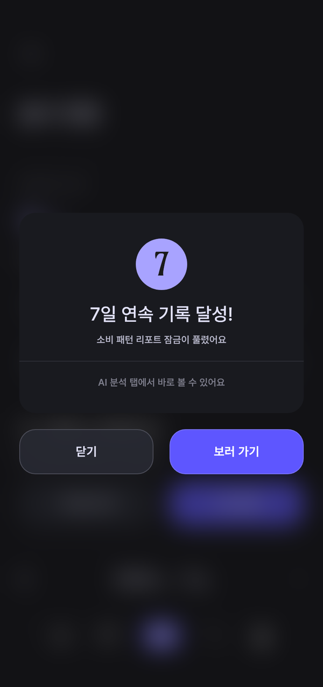 |

### 시작하기와 알림 설정

| 온보딩 | 로그인 | 알림 설정 |
| :---: | :---: | :---: |
| 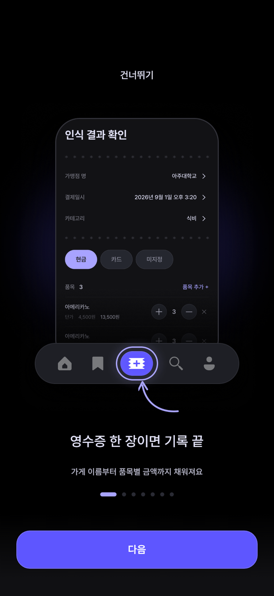 | 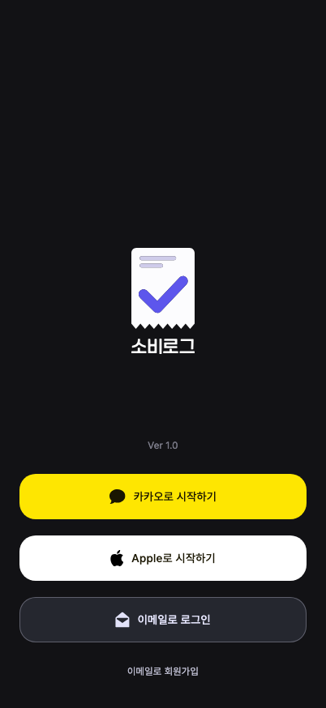 | 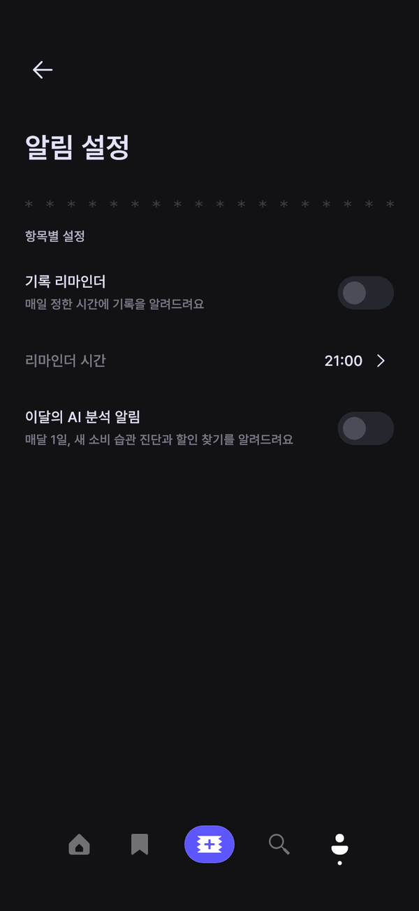 |

## 기술 스택

| 영역 | 사용 기술 |
| --- | --- |
| 앱 UI | Flutter, Dart, Material, flutter_svg |
| API·세션 | http, flutter_secure_storage |
| 로그인·공유 | Kakao User·Share SDK, sign_in_with_apple, url_launcher |
| 사진·파일 | image_picker, path_provider |
| 알림·설정 | flutter_local_notifications, timezone, shared_preferences |
| 환경·로그 | flutter_dotenv, logger |
| 테스트 | flutter_test, 위젯·골든·API 흐름 테스트 |

## 프로젝트 구조

```text
lib/
├── main.dart             # 앱 초기화, 테마와 화면 진입
├── core/
│   ├── config/           # 환경 설정
│   ├── network/          # API 클라이언트, 세션, 서비스 주입
│   ├── notifications/    # 로컬 알림 예약과 화면 이동
│   ├── storage/          # 앱 설정 저장
│   └── theme/            # 색상과 테마
├── features/
│   ├── auth/             # 이메일·카카오·Apple 인증
│   ├── register/         # 영수증 인식 결과·직접 입력·수입 등록
│   ├── ledger/           # 기간별 조회, 필터와 내역 편집
│   ├── category/         # 카테고리 관리
│   ├── analysis/         # 소비 리포트, 목표와 AI 분석
│   ├── dutch/            # 품목 배정, 정산 결과와 공유
│   ├── profile/          # 프로필, 출석, 보상과 알림 설정
│   └── …                 # 홈, 온보딩, 스플래시, 금융 API
└── shared/widgets/       # 영수증 폼, 입력창과 공통 UI
test/                     # 기능·회귀·시각 테스트
assets/                   # 아이콘, 이미지, 폰트와 은행 로고
ios/                      # iOS 네이티브 설정
```

## 사전 준비

- Flutter 3.44.0 이상
- Dart 3.12.0 이상
- iOS 실행 시 Xcode와 CocoaPods

설치 상태는 다음 명령으로 확인합니다.

```bash
flutter doctor
```

## 로컬 실행

### 1. 저장소 준비

```bash
git clone https://github.com/paran-accountbook/frontend.git
cd frontend
```

### 2. 환경 변수 설정

`.env.example`을 복사해 Git에 포함되지 않는 로컬 설정 파일을 만듭니다. `.env`는 Flutter 의존성을 받거나 앱을 빌드하기 전에 준비해야 합니다.

```bash
cp .env.example .env
```

`.env`에서 실행 환경에 맞는 값을 설정합니다.

```dotenv
APP_ENV=development
API_BASE_URL=https://api.sobilog.kr/
TERMS_DOCUMENT_URL=
KAKAO_NATIVE_APP_KEY=
ENABLE_DEBUG_LOG=true
```

| 변수 | 용도 |
| --- | --- |
| `APP_ENV` | 실행 환경. 기본값은 `development` |
| `API_BASE_URL` | 연결할 백엔드 API 주소 |
| `TERMS_DOCUMENT_URL` | 약관 문서 주소 |
| `KAKAO_NATIVE_APP_KEY` | 카카오 로그인·공유 SDK 초기화 키 |
| `ENABLE_DEBUG_LOG` | 디버그 로그 활성화 설정 |

카카오 기능을 테스트하려면 해당 앱에 등록된 네이티브 앱 키와 플랫폼 설정이 필요합니다. Apple 로그인은 iOS 서명 및 Sign in with Apple 설정이 필요합니다.

`API_BASE_URL` 끝의 `/` 유무는 모두 지원합니다. `.env`에는 비밀값을 넣을 수 있으므로 커밋하지 않습니다.

### 3. 의존성 설치

```bash
flutter pub get
```

### 4. 실행 기기 확인

```bash
flutter devices
```

iOS 시뮬레이터가 보이지 않으면 macOS에서 다음 명령으로 실행합니다.

```bash
open -a Simulator
```

Android 실행에는 Android 네이티브 프로젝트와 SDK 설정을 먼저 준비해야 합니다. 현재 저장소에는 `android/` 폴더가 포함되어 있지 않습니다.

### 5. 앱 실행

연결된 기기가 하나라면 다음 명령으로 실행합니다.

```bash
flutter run
```

기기가 여러 개라면 `flutter devices`에 표시된 ID를 지정합니다.

```bash
flutter run -d <device-id>
```

## 검사 및 테스트

```bash
flutter analyze
flutter test
```

iOS 시뮬레이터용 빌드만 확인하려면 다음 명령을 사용합니다.

```bash
flutter build ios --simulator --no-codesign
```

## 자주 발생하는 문제

### 환경 변수 변경이 반영되지 않음

Hot Reload만 하지 말고 앱을 완전히 종료한 뒤 `flutter run`을 다시 실행합니다. 필요하면 빌드 캐시를 정리합니다.

```bash
flutter clean
flutter pub get
flutter run
```

### iOS 의존성 오류

```bash
cd ios
pod install
cd ..
flutter run
```

### API 연결 실패

- `.env`의 `API_BASE_URL`이 실제 접근 가능한 주소인지 확인합니다.
- `https://<주소>/health`가 `200`을 반환하는지 확인합니다.
- iOS·Android 기기의 네트워크 연결 상태를 확인합니다.

## 관련 문서

- [백엔드 API 문서](https://api.sobilog.kr/docs)
- [서비스 소개와 전체 화면](https://github.com/paran-accountbook/.github/blob/main/README.md)
- [프로젝트 개발 규칙](AGENTS.md)
- [브랜치·커밋·PR 규칙](.agents/docs/branch.md)
